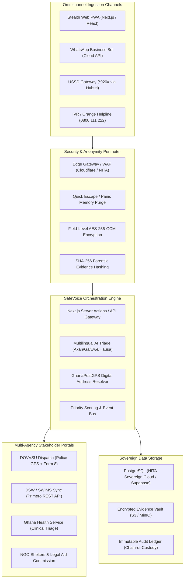
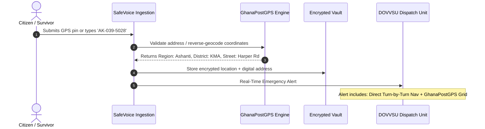

# Republic of Ghana — National SafeVoice Initiative
## Digital Public Infrastructure (DPI) Blueprint & Product Requirements Document (PRD)
### Transforming Crisis Reporting, Case Management, and Inter-Agency Intervention into Sovereign Digital Infrastructure

---

| **Document Version** | 2.0-NATIONAL-DPI |
| **Status** | Prepared for Technical Lead & Inter-Ministerial Review |
| **Convened Council** | Lead Architect, Legal/DPI Counsel, Security/Forensics Specialist, Trauma-Informed UX Director, National Telecoms Specialist |
| **Target Sponsoring Agencies** | Ministry of Gender, Children and Social Protection (MoGCSP), Ghana Police Service (DOVVSU), Department of Social Welfare (DSW), Ghana Health Service (GHS), Cyber Security Authority (CSA), National Information Technology Agency (NITA), UNICEF Ghana |
| **Storage Location** | `/docs/NATIONAL_SAFEVOICE_BLUEPRINT_PRD.md` |

---

## 🏛️ PART I: THE COUNCIL OF AGENTS — GRILLING & RECONSTRUCTION

Before formulating this PRD, a specialized **Council of 5 Specialist Agents** convened to aggressively grill the existing SafeVoice prototype, benchmark it against Ghana's institutional realities, and expose why previous digital initiatives in Ghana failed.

```
                             ┌────────────────────────────────────────┐
                             │       ORCHESTRATOR / TECH LEAD         │
                             └──────────────────┬─────────────────────┘
                                                │
       ┌───────────────────┬────────────────────┼───────────────────┬───────────────────┐
       ▼                   ▼                    ▼                   ▼                   ▼
┌──────────────┐    ┌──────────────┐    ┌──────────────┐    ┌──────────────┐    ┌──────────────┐
│  ARCHITECT   │    │  LEGAL & DPI │    │  SECURITY &  │    │TRAUMA-INFORM │    │ TELECOMS &   │
│    AGENT     │    │  RESEARCHER  │    │  FORENSICS   │    │   ED UX      │    │  OPERATIONS  │
└──────────────┘    └──────────────┘    └──────────────┘    └──────────────┘    └──────────────┘
```

### 1. The Grilling Dimensions: What Failed in Ghana & Why?

#### A. The Autopsy of the "Boame App" (MoGCSP / UNFPA, 2021)
*   **The App Store Penalty**: Boame required victims to download an APK from Google Play. In Ghana, low-income citizens and youth predominantly own budget Android phones (16GB–32GB storage) where storage is perpetually exhausted by WhatsApp, photos, and system caches. Forcing an app download creates an immediate drop-off rate exceeding 80%.
*   **The Discovery Trap (Deadly Device Footprint)**: If an abuser conducts an impromptu phone check and discovers an app titled "Boame" or "SGBV Report" on the home screen, the victim faces immediate, escalated physical retaliation.
*   **The Data Divide**: The app required a continuous mobile data connection. In rural or peri-urban Ghana, mobile data is rationed; victims in active distress cannot purchase data bundles to report abuse.
*   **Verdict**: *SafeVoice must NEVER be an app-store-only dependency. It must be zero-install (progressive web portal, WhatsApp bot, and USSD).*

#### B. The Autopsy of SWIMS / Primero (MoGCSP / UNICEF)
*   **The "Back-Office Silo"**: SWIMS is a robust case-management tool for trained social workers, but it is **completely inaccessible to victims**. A victim must physically present themselves at a Social Welfare office or police station to have a file opened.
*   **The "Inter-Agency Wall"**: When DOVVSU (police) logs a report in their internal station books, it does not automatically synchronize with SWIMS. Victims must retell their trauma separately to a police constable, a hospital triage nurse, and a social welfare officer.
*   **Verdict**: *SafeVoice must NOT try to replace SWIMS. SafeVoice must be the **Citizen Ingestion & Real-Time Orchestration Layer** that pushes interoperable case events into SWIMS and DOVVSU stations simultaneously via open APIs.*

#### C. The "Police Form 8" Bottleneck
*   In Ghanaian criminal law, a victim of sexual or physical assault cannot receive formal government forensic examination without **Ghana Police Form 8** issued by DOVVSU.
*   Victims are often sent on a wild goose chase: from the clinic to the police station to get Form 8, then back to a public hospital (Korle-Bu, 37 Military, Ridge, or KATH) where doctors demand unreceipted medical endorsement fees ranging from GH₵300 to GH₵1,200—which victims cannot afford. Evidence is lost within 72 hours.
*   **Verdict**: *SafeVoice must digitize **Police Form 8 dispatch**, allowing an accredited clinician to initiate or receive digital Form 8 authorizations instantly.*

---

## 📋 PART II: EXECUTIVE SUMMARY & STRATEGIC MANDATE

### 1. Vision Statement
To establish **SafeVoice** as the Sovereign National Digital Public Infrastructure (DPI) of the Republic of Ghana for crisis intervention, gender-based violence (GBV) reporting, child protection, and holistic victim care.

### 2. Core Pillars of the Transformation
1.  **Omnichannel Accessibility**: Zero barrier to entry. Reachable via:
    *   **Stealth Web PWA**: Zero-footprint web access with instant Quick Escape and camouflage skins.
    *   **WhatsApp AI Bot**: Conversational voice-note reporting via Ghana's primary messaging network.
    *   **Offline USSD (`*XXX#`)**: 100% data-free access on basic "yam" (feature) phones via national aggregators.
    *   **Toll-Free IVR / Voice Routing**: Direct integration with the Orange Support Centre (`0800 111 222`) and DOVVSU (`055 1000 900`).
2.  **Sovereign Data Protection & Cryptographic Integrity**:
    *   Full compliance with the **Data Protection Act, 2012 (Act 843)** as "Special Personal Data".
    *   Tamper-evident chain of custody satisfying the **Evidence Act, 1975 (NRCD 323)** and **Electronic Transactions Act, 2008 (Act 772)**.
    *   Architecture engineered for data residency on the **National Information Technology Agency (NITA) Sovereign Cloud** and Ghana National Data Centre.
3.  **Trauma-Informed & Multilingual First-Response**:
    *   First-responder AI capable of triaging voice recordings and text in **Akan (Asante Twi, Fante), Ga, Ewe, Dagbani, Hausa, and English**.
    *   Vicarious trauma protection for caseworkers (automated blurring of graphic wounds/evidence until explicitly requested).
4.  **National Inter-Agency Case Orchestration**:
    *   A single report creates twin synchronized tracks:
        *   **Track A (Criminal Enforcement)**: Forwarded to the nearest DOVVSU patrol/station with GPS and **GhanaPostGPS** digital address.
        *   **Track B (Social Care & Protection)**: Forwarded to Department of Social Welfare (DSW), CHRAJ, shelter networks (e.g., The Ark Foundation), and Legal Aid Commission.

---

## ⚖️ PART III: GHANAIAN LEGAL, INSTITUTIONAL & EVIDENTIARY FRAMEWORK

```
┌─────────────────────────────────────────────────────────────────────────────┐
│                       GHANAIAN LEGAL & POLICY FOUNDATION                     │
├────────────────────────┬──────────────────────────┬─────────────────────────┤
│ Domestic Violence Act  │ Children's Act, 1998     │ Electronic Transactions │
│ 2007 (Act 732)         │ (Act 560)                │ Act, 2008 (Act 772)     │
│ Mandates state care,   │ Paramount interest of    │ Validates admissibility │
│ police protection & DV │ child; mandatory filing  │ of digital records,     │
│ support fund.          │ of abuse reports.        │ hashes & timestamps.    │
├────────────────────────┼──────────────────────────┼─────────────────────────┤
│ Data Protection Act    │ Cybersecurity Act, 2020  │ Evidence Act, 1975      │
│ 2012 (Act 843)         │ (Act 1038)               │ (NRCD 323)              │
│ Governs special data,  │ Critical Information     │ Strict rules on chain   │
│ consent & cross-border │ Infrastructure (CII)     │ of custody & electronic │
│ transfer restrictions. │ standards & audits.      │ authenticity.           │
└────────────────────────┴──────────────────────────┴─────────────────────────┘
```

### 1. Digital Evidence Admissibility (Act 772 & NRCD 323)
To ensure that digital recordings, photographs, and chat transcripts gathered via SafeVoice are not thrown out in a Ghanaian Circuit Court or High Court:
1.  **Tamper-Evident SHA-256 Hashing**: Every audio note, video, or photograph uploaded must be hashed at the exact point of intake (client/edge). The SHA-256 hash, UTC timestamp, file size, MIME type, and capture device telemetry must be written to an immutable audit table.
2.  **Affidavit-Ready Evidence Package**: The system must generate a 1-click **Digital Evidence Dossier (PDF/A)** accompanied by a cryptographic certificate signed by the SafeVoice Evidence Officer verifying that the file was not altered, compressed, or tampered with since upload.
3.  **Constitutional Privacy Safeguards (*Raphael Cubagee v. Michael Yeboah Asare*)**: The Supreme Court of Ghana affirmed that secretly recorded communications violate Article 18(2) of the 1992 Constitution unless legally justified. SafeVoice must display explicit user declarations: *"I certify that this evidence is submitted voluntarily for the purpose of seeking legal protection, medical assistance, or criminal investigation."*

### 2. Data Protection & Sovereign Residency (Act 843 & NITA)
1.  **Special Category Personal Data**: Under Section 37 of Act 843, data concerning a person's physical or mental health, sexual life, or alleged commission of an offence cannot be processed without strict justification or express consent.
2.  **Data Controller Registration**: SafeVoice must register with the **Data Protection Commission (DPC)** as a national critical processor.
3.  **Sovereignty Tiering**:
    *   *Pilot Phase*: Cloud-native deployment (Vercel + Supabase encrypted at rest) using Ireland/EU data centers (recognized by DPC as an adequate jurisdiction).
    *   *National Production Phase*: Migration of the primary PostgreSQL database and storage buckets to **NITA National Data Centre (Accra / Kumasi)** to satisfy national security requirements under Act 1038.

### 3. Digitizing Ghana Police "Form 8"
1.  SafeVoice introduces the **e-Form 8 Workflow**:
    *   When an emergency report indicates physical trauma or rape within 72 hours, an alert triggers on the DOVVSU station dashboard.
    *   The DOVVSU Station Officer clicks **"Issue Digital Form 8"**, generating a QR-coded, encrypted medical examination voucher.
    *   The victim presents this QR code at any accredited public hospital (Korle-Bu, Ridge, 37 Military, KATH, or regional hospitals).
    *   The examining physician logs into the **SafeVoice Medical Sub-Portal**, inputs clinical findings, attaches forensic photo notes, and cryptographically signs the record.
    *   The clinical report synchronizes directly back to DOVVSU and DSW without the victim having to courier sensitive paper forms across town.

---

## 🏗️ PART IV: SYSTEM ARCHITECTURE & TECHNICAL SPECIFICATIONS

### 1. High-Level Omnichannel Architecture



### 2. Detailed Technical Specifications

| Architectural Tier | Technology / Provider | Purpose & Justification |
| :--- | :--- | :--- |
| **Frontend Web App** | Next.js 14+ (App Router), TailwindCSS, TypeScript | Blazing-fast PWA; works on low-spec 3G mobile devices; supports offline caching of emergency contacts via IndexedDB. |
| **WhatsApp Gateway** | Meta WhatsApp Business Cloud API + Webhook Worker | Captures voice notes and location pins from 90%+ of Ghanaian smartphone users without requiring app installation. |
| **USSD Gateway** | Hubtel or Africa's Talking Ghana API (`*920*XXX#`) | Enables 100% offline, zero-data crisis reporting on 2G feature phones; dials directly into DOVVSU dispatch. |
| **AI Triage & Translation** | Whisper-Large-v3 (Fine-tuned for Ghanaian Accents) + Gemini 1.5 Flash / OpenRouter Fallback | Transcribes voice notes in Ghanaian English, Asante Twi, and Pidgin; normalizes unstructured trauma into structured police summaries. |
| **Location Intelligence** | GhanaPostGPS API + OpenStreetMap / Mapbox GL | Converts raw latitude/longitude into Ghanaian 5m x 5m digital addresses (e.g., `GA-183-9022`) for DOVVSU vehicle dispatch. |
| **Backend Database** | PostgreSQL 16 with Row-Level Security (RLS) & pgvector | Secure relational storage with strict cryptographic multi-tenancy; vector search for matching repeat offenders/locations. |
| **Storage Vault** | Supabase Storage / NITA MinIO Object Storage | AES-256-encrypted object storage with zero-knowledge presigned URLs expiring in 15 minutes. |
| **Inter-Agency Sync** | Primero / SWIMS v2 REST API Webhooks | Pushes social care cases into the national UNICEF/MoGCSP SWIMS backend to prevent duplicate case files. |

---

## ⚙️ PART V: FUNCTIONAL REQUIREMENTS MATRIX

### 1. What Stays (Validated Prototype Core)
*   **Zero-Obligation Voice Reporting**: Victims can submit audio recordings without typing a single word (`ReportForm.tsx` & `server/actions/report.ts`).
*   **Quick Escape ("Leave Site")**: Global emergency exit button that wipes state and redirects to BBC/Google instantly; dual-press `Esc` keyboard shortcut.
*   **12-Character Anonymous Reference Tracker**: Code-based tracking (`SV-XXXX-XXXX`) allowing victims to view case milestones and safely communicate with assigned caseworkers without personal accounts.
*   **Trauma-Informed Design Aesthetic**: Warm slate, calming sage/emerald, high-contrast accessible typography, devoid of triggering sirens or interrogative UI.
*   **Interactive Regional Geospatial Map**: Mapbox-powered visualization of regional incident clusters across Ghana's 16 administrative regions (`/admin/analytics`).

### 2. What Changes (Refactoring Prototype Weaknesses)
*   **Replace Generic US Hotlines with Verified Ghanaian Infrastructure**:
    *   *DOVVSU Police Headquarters*: `055 1000 900` / `18555`
    *   *National Emergency Police*: `112` / `191`
    *   *MoGCSP / UNFPA Orange Support Centre*: `0800 111 222` (Toll-free)
    *   *Legal Aid Commission Ghana*: `0302 669 220`
    *   *Child Protection Helpline (Social Welfare)*: `0800 800 800`
*   **Replace Plain Address Strings with Dual-Location Input**:
    *   *Field 1*: GPS auto-detect (lat/lng coordinates).
    *   *Field 2*: **GhanaPostGPS Digital Address** (e.g., `GA-492-1024`), the gold standard for police and ambulance dispatch in Ghana.
    *   *Field 3*: Popular Landmark / Junction (essential in Ghana, e.g., *"Behind Shell filling station, near the market circle"*).
*   **Refactor Caseworker Triage Portal**:
    *   Currently single-tier admin; must be split into **Strict Multi-Agency RBAC**:
        *   `Role: dovvsu_officer` (Sees crime details, evidence, perpetrator identity, dispatch actions).
        *   `Role: social_worker` (Sees psychosocial needs, child custody, shelter requirements, family history).
        *   `Role: healthcare_provider` (Sees medical injury history, Form 8 clinical uploads).
        *   `Role: mogcsp_executive` (Sees purely aggregated, anonymized regional policy heatmaps).

### 3. What to Add (New Breakthrough Capabilities)

#### A. The WhatsApp Voice-Reporting Bot
*   **Concept**: 92% of Ghanaian internet users use WhatsApp daily.
*   **Workflow**:
    1.  User sends "HELP" or a voice note to SafeVoice Ghana's verified WhatsApp number (`+233 55 ...`).
    2.  The automated bot responds gently in the user's preferred language (English, Twi, Ga, Ewe, Hausa).
    3.  User sends a voice note explaining what happened and taps "Share Current Location".
    4.  The system ingests the voice note, hashes it with SHA-256, transcribes it via Whisper, translates key indicators into an English incident brief, resolves the location to a GhanaPostGPS address, and files an encrypted case record.
    5.  The bot returns: *"Your confidential reference code is SV-7281-GH. Your report has been dispatched to DOVVSU Accra Central. To erase this chat immediately, reply 'CLEAR'."*

#### B. The Offline USSD Emergency Channel (`*920*22#`)
*   **Concept**: Reaches the 45% of Ghanaians in rural villages and market centers using basic feature phones without data.
*   **Workflow**:
    1.  Citizen dials `*920*22#` (zero-rated, works without airtime).
    2.  Menu:
        *   `1. Report Danger (Emergency Police Dispatch)`
        *   `2. Domestic Violence Support`
        *   `3. Child Abuse / Neglect`
        *   `4. Request Call Back from Social Worker`
    3.  User selects region and enters digital address or nearest town.
    4.  An instant SMS confirmation with reference code is dispatched, and DOVVSU's rapid response unit is queued.

#### C. The Digital "Form 8" Medical Examination Hub
*   Directly solves the national medical evidence bottleneck.
*   Generates accredited digital vouchers for free/state-subsidized medical examinations at Ghana Health Service facilities.
*   Enables doctors to upload signed photographic and clinical notes directly into the encrypted case file, eliminating lost paper records.

#### D. Camouflage & Stealth Web Skin ("The Calculator / Weather Skin")
*   For victims living with their abusers, visiting a site with "SafeVoice" in the browser tab is dangerous.
*   SafeVoice includes a **"Disguise Portal"** toggle:
    *   Clicking **"Stealth Mode"** instantly transforms the UI into a fully functioning **Scientific Calculator** or **Ghana Weather Tracker**.
    *   Typing a secret PIN (e.g., `1234=`) in the calculator unlocks the encrypted reporting portal.
    *   The browser tab title displays *"Ghana Meteorological Services"* or *"Online Calculator"*, completely hiding the crisis portal during shoulder-surfing.

#### E. Caseworker Vicarious Trauma Protection (Media Safe-Shield)
*   Caseworkers reviewing 50 reports a day suffer severe vicarious trauma from graphic photos of lacerations, burns, and child sexual abuse.
*   **Rule**: All uploaded media is automatically blurred with a heavy Gaussian blur and flagged with a content warning (*"Image contains physical trauma. Click to inspect for forensic review"*).
*   Mandatory case review limits (maximum 15 high-severity cases per caseworker per day) with automated wellness break prompts.

---

## 🗺️ PART VI: GHANA-SPECIFIC INNOVATIONS & DATA RESOLUTION

### 1. GhanaPostGPS Digital Address Resolver Workflow



### 2. Multi-Dialect Acoustic Pipeline
*   Trauma disclosures in Ghana are rarely delivered in Queen's English. Victims express emotional distress in colloquial vernacular:
    *   *Twi*: *"Me kunu abɔ me abɔbrɔso, ɔrebɔ me ti ase..."* (My husband has beaten me mercilessly, threatening my life...)
    *   *Pidgin*: *"The man dey lock me inside room, he dey beat me everyday..."*
    *   *Ga*: *"Ebe mi kɛ dade..."*
*   **The SafeVoice Pipeline**:
    1.  Audio recording is ingested in `.m4a` or `.webm` format.
    2.  Whisper-Large-v3 multilingual model identifies the spoken dialect.
    3.  The raw audio is stored with its SHA-256 hash intact as primary legal evidence.
    4.  An automated dual-transcript is generated:
        *   **Original Verbatim Transcript**: Word-for-word local language text.
        *   **Certified English Forensic Translation**: For immediate action by DOVVSU detectives and courtroom prosecutors.

---

## 🚀 PART VII: PHASED NATIONAL ROLLOUT & IMPLEMENTATION ROADMAP

```
┌──────────────────────────────────────────────────────────────────────────────────────────┐
│                             NATIONAL PHASED ROLLOUT ROADMAP                              │
├──────────────────────┬──────────────────────────┬────────────────────────────────────────┤
│ PHASE 1 (Months 1-3) │ PHASE 2 (Months 4-6)     │ PHASE 3 (Months 7-12)                  │
│ "PWA & Core Pilot"   │ "Omnichannel Ingestion"  │ "National DPI & Sovereign Integration" │
├──────────────────────┼──────────────────────────┼────────────────────────────────────────┤
│ • Production PWA     │ • WhatsApp Bot Gateway   │ • NITA Sovereign Cloud Migration       │
│ • DOVVSU Accra &     │ • Hubtel USSD (*920#)    │ • Full SWIMS / Primero REST Bridge     │
│   Kumasi pilot       │ • GhanaPostGPS Resolver  │ • 16-Region National Rollout           │
│ • Anonymous tracker  │ • Digital Form 8 Pilot   │ • Ministry of Finance / DV Fund        │
│ • Forensic Hashing   │ • GHS Hospital Nodes     │   Statutory Budget Line                │
└──────────────────────┴──────────────────────────┴────────────────────────────────────────┘
```

### Phase 1: Prototype Hardening & Greater Accra / Ashanti Pilot (Months 1–3)
*   Deploy hardened Next.js PWA with zero-knowledge encryption and SHA-256 media hashing.
*   Equip DOVVSU Headquarters (Accra Central) and Kumasi Central Station with the Caseworker Portal.
*   Integrate official Ghanaian emergency hotlines and verified shelter directories.
*   Establish data controller compliance certification with the Ghana Data Protection Commission (DPC).

### Phase 2: Omnichannel Channels & Healthcare Bridge (Months 4–6)
*   Launch the SafeVoice WhatsApp Business API assistant for voice-note reporting.
*   Deploy USSD shortcode through Hubtel / Africa's Talking Ghana for offline feature phones.
*   Roll out the **Digital Form 8 Pilot** across 4 major hospitals:
    *   Korle-Bu Teaching Hospital (Accra)
    *   Komfo Anokye Teaching Hospital (Kumasi)
    *   Greater Accra Regional Hospital (Ridge)
    *   Tamale Teaching Hospital (Northern Region)

### Phase 3: Sovereign Cloud & National Inter-Agency DPI (Months 7–12)
*   Migrate production database and secure evidence vaults to the **NITA Sovereign Cloud (Accra)**.
*   Formalize bi-directional API synchronization with MoGCSP / UNICEF's **SWIMS** (Primero).
*   Expand to all 16 administrative regions of Ghana.
*   Establish an institutionalized budget line supported by the statutory **Domestic Violence Support Fund (Act 732)** and international partners (UNICEF, UNFPA, UNDP).

---

## ❓ PART VIII: KEY DECISIONS & OPEN QUESTIONS FOR TECHNICAL LEAD

The Council has highlighted 4 pivotal decisions requiring executive sign-off before proceeding with engineering tickets:

1.  **USSD Aggregator Selection**:
    *   *Option A (Recommended)*: **Hubtel Ghana** — Deepest direct integration with MTN Ghana, Telecel, and AT; proven 99.9% uptime for national mobile money.
    *   *Option B*: **Africa's Talking Ghana** — Highly developer-friendly API and lower setup friction for pilot.
2.  **Audio AI Architecture (Sovereign vs. Cloud API)**:
    *   *Option A (Hybrid Cloud)*: Use OpenRouter / Groq / OpenAI Whisper Cloud for rapid transcription during pilot, storing no audio in the AI vendor's training logs.
    *   *Option B (Sovereign Local)*: Self-host Whisper-Large-v3 on a dedicated GPU container within Ghana's National Data Centre (guarantees 100% data residency, but increases infrastructure operating costs).
3.  **Digital Form 8 Legal Sign-Off**:
    *   Will the Attorney General's Department and Ghana Police Service accept a digitally signed PDF Form 8 with an embedded cryptographic hash, or must the system generate a printable standard Form 8 with an ink-stamp verification box? *(Council recommendation: Hybrid printable PDF with QR verification code).*
4.  **WhatsApp Bot Hosting Tier**:
    *   Use Meta Cloud API direct, or partner with a Ghanaian BSP (Business Solution Provider) like Hubtel to ensure local currency billing (GHS) and zero-rated data agreements with telcos.

---

## 📜 PART IX: COUNCIL SIGN-OFF

| Council Role | Verdict | Key Condition |
| :--- | :--- | :--- |
| **Lead Architect** | **APPROVED** | Strict asynchronous event queue between citizen intake and police dispatch; zero single-point-of-failure. |
| **Legal & DPI Researcher** | **APPROVED** | Mandatory SHA-256 evidentiary chain of custody and full Act 843 registration with the Data Protection Commission. |
| **Security & Forensics Specialist** | **APPROVED** | Zero-knowledge field encryption on survivor PII; instant cache wipe upon Quick Escape trigger. |
| **Trauma-Informed UX Director** | **APPROVED** | Mandatory stealth camouflage mode; zero mandatory typing for distressed survivors; caseworker trauma shields. |
| **National Telecoms Specialist** | **APPROVED** | USSD and WhatsApp must be treated as first-class citizens alongside the web portal to overcome Ghana's device divide. |

---
*Document produced and registered under `/docs/NATIONAL_SAFEVOICE_BLUEPRINT_PRD.md`.*
