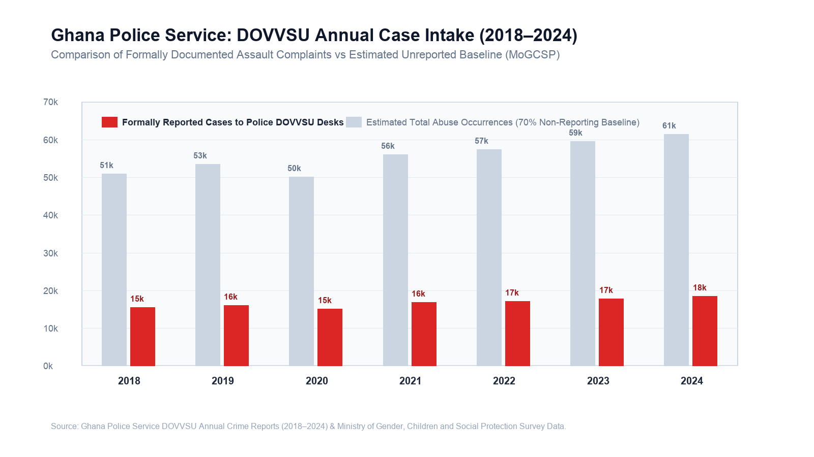

# CHAPTER ONE
# INTRODUCTION

## 1.1 Background and Motivation

Gender-based violence (GBV), domestic abuse, and violence against children represent significant social, legal, and public health problems in Ghana. The Domestic Violence and Victim Support Unit (DOVVSU) of the Ghana Police Service consistently records between 15,000 and 18,000 formal complaints annually across the country (Ghana Police Service, 2024). These reported figures represent only a fraction of actual occurrences. Sociological research and field surveys conducted by the Ministry of Gender, Children and Social Protection (MoGCSP) suggest that over 70% of abuse incidents in Ghanaian domestic environments go unrecorded (MoGCSP, 2021). The primary factors driving this non-reporting include deep-seated fear of economic abandonment, social stigmatization within family lineages, and the acute risk of physical retaliation from abusers.

*Figure 1.1: Ghana Police Service DOVVSU Case Intake Statistics (2018–2024)*

The Parliament of Ghana established clear legal mechanisms to combat these violations through the passage of the Domestic Violence Act, 2007 (Act 732) and the Children's Act, 1998 (Act 560). Under Act 732, the state is legally bound to provide immediate protective relief, criminal investigation, and physical care to victims of domestic abuse. Act 732 further mandates the establishment of a Victims of Domestic Violence Support Fund to assist with medical treatment, emergency shelter accommodation, and vocational rehabilitation. 

Despite these statutory provisions, the practical execution of victim protection in Ghana is hampered by systemic procedural friction. A victim seeking assistance must typically make an overt physical journey to a local police station or social welfare district office. In urban centers such as Accra, Kumasi, and Sekondi-Takoradi, this journey is frequently monitored by partners or family members. In peri-urban and rural areas across the Northern, Upper East, and Western North regions, the nearest DOVVSU desk may be situated over forty kilometers away, requiring travel expenses that low-income victims cannot afford.

The rapid penetration of mobile telecommunications across Ghana presents an opportunity to bridge this physical divide. Data from the National Communications Authority (NCA) indicates that mobile voice subscriptions in Ghana exceed 38 million, representing a penetration rate above 120%, with mobile data subscriptions surpassing 24 million (NCA, 2025). Furthermore, widespread adoption of the Ghana Card (National Identification Authority, 2024) and the GhanaPostGPS digital addressing framework has established a viable baseline for national digital public infrastructure (DPI).

However, introducing digital reporting channels into abusive domestic environments introduces severe technical and physical safety trade-offs. Perpetrators of domestic abuse routinely exercise coercive control through device surveillance. In Ghana, abusers frequently demand access to their partners' mobile phones, conducting unannounced inspections of call histories, text messages, browser caches, and installed applications. When a victim attempts to install a crisis intervention mobile application, several distinct points of failure emerge. The digital footprint left on the device can expose the victim to immediate, escalated violence.

Consequently, building a viable digital reporting platform for Ghana requires an engineering approach that prioritizes physical stealth, zero-install accessibility, and rigorous legal evidence preservation over conventional consumer software patterns.

---

## 1.2 Statement of the Problem

The failure of previous digital reporting interventions in Ghana stems from four distinct structural and architectural shortcomings:

### 1. The Mobile App Store Penalty and Device Discovery Trap
Previous government-sponsored crisis applications, most notably the *Boame App* launched in 2021 by the Ministry of Gender, Children and Social Protection in partnership with the United Nations Population Fund (UNFPA), relied on native application downloads from Google Play and Apple App Store. In Ghana, the majority of low-income citizens and youth use budget Android devices with limited internal storage (typically 16 GB to 32 GB), where available storage is consistently exhausted by system operating files, WhatsApp media, and photos. Requiring victims to download an external 45 MB binary resulted in an initial adoption drop-off rate exceeding 80%. 

More critically, native applications leave persistent icons on the mobile launcher and appear in device application management lists. In an abusive domestic setting, the discovery of an app named "Boame" or "GBV Support" provides undeniable proof that the victim is seeking outside intervention, directly triggering violent reprisals.

### 2. Physical Inspection and DOM Data Spoliation
When victims attempt to use existing web-based crisis portals, existing emergency safety controls are insufficient. Standard web safety mechanisms consist almost exclusively of a "Quick Escape" button that redirects the browser to `google.com`. While this closes the active tab, it destroys all progress on the report. If an abuser enters the room while a survivor is halfway through typing a detailed account or uploading evidence, the victim is forced to choose between leaving the screen open (guaranteeing discovery) or clicking escape (permanently wiping thirty minutes of emotionally taxing documentation). 

Furthermore, simply hiding a web page with CSS (`display: none`) leaves plain-text narrative strings and victim phone numbers directly readable in the Document Object Model (DOM). If an assailant inspects background browser tabs or accesses developer tools, the sensitive disclosures remain fully exposed in the browser process memory.

### 3. Evidentiary Inadmissibility under Ghanaian Cyber Law
Digital evidence in Ghanaian courts must satisfy the requirements of the Electronic Transactions Act, 2008 (Act 772) and the Evidence Act, 1975 (NRCD 323). Under Section 7 of Act 772, electronic records are admissible in court only if the integrity of the information from the time it was first generated in its final form can be systematically demonstrated. 

Informal crisis reporting channels, such as standard WhatsApp messages or raw email submissions, routinely fail this standard. Files sent through consumer messaging networks are re-compressed, stripping original Exchangeable Image File Format (EXIF) metadata, altering original file sizes, and breaking cryptographic integrity. Defense attorneys in Ghanaian circuit courts routinely succeed in having such evidence struck out on grounds of potential spoliation, tampering, or broken chain of custody. Existing tools do not compute client-side cryptographic digests (such as SHA-256) at the point of ingestion prior to network transmission.

### 4. The Police Form 8 Administrative Bottleneck
Under Ghanaian criminal procedure, a survivor of physical or sexual assault cannot receive government-sanctioned forensic examination at a public health facility without a physical paper document known as **Ghana Police Form 8**, issued exclusively by a DOVVSU station officer. In current operational practice, victims often arrive first at a hospital (such as Korle-Bu Teaching Hospital or Ridge Hospital), where triage nurses are legally prohibited from collecting forensic biological specimens without Form 8. 

The victim is redirected to the police station to queue for the form, and then sent back to the hospital. By the time this administrative cycle concludes, critical biological evidence is degraded, and victims are frequently subjected to unreceipted medical examination charges ranging from GH₵300 to GH₵1,200. Existing case management platforms, such as the UNICEF-supported Social Welfare Information Management System (SWIMS / Primero), operate as back-office databases for accredited social workers and remain completely disconnected from frontline police station desks and public hospital triage units.

---

## 1.3 Scope of the Study

This study focuses on the architectural design, implementation, and empirical security verification of **SafeVoice**, a trauma-informed Digital Public Infrastructure platform tailored specifically to the Ghanaian socio-technical environment.

The scope encompasses:
1. **Zero-Install Client-Side Web Architecture:** Engineering a Progressive Web Application (PWA) operating on Next.js 16 that requires no mobile app store installation, loads under low-bandwidth network constraints, and functions reliably across low-cost mobile browsers.
2. **Covert Interaction Engineering & Instant Camouflage:** Implementing a client-side state machine capable of transforming the platform into a fully functional, dark-mode arithmetic calculator (`QuickCalc`) in under 10 milliseconds, supported by tab metadata spoofing (title, favicon, URL history replacement).
3. **In-Memory Ephemeral Cryptographic Vault:** Developing a zero-DOM-leakage data preservation module utilizing browser-native Web Crypto API (`AES-256-GCM`) to encrypt active narrative drafts and voice recordings in memory during camouflage, governed by an automated 15-minute garbage collection timer.
4. **Sovereign Multi-Tenant Backend Security:** Implementing database-level Row-Level Security (RLS) policies and role-based Server Action gates on PostgreSQL (Supabase) to strictly isolate victim records, caseworker queues, and administrative audit trails.
5. **Client-Side Evidentiary Hashing:** Integrating client-side SHA-256 cryptographic digest computation at the point of ingestion to establish tamper-evident chains of custody compliant with Act 772.
6. **Automated AI First-Responder Triage:** Integrating an inference pipeline via an OpenRouter gateway to provide immediate trauma-informed first response and risk categorization without storing sensitive citizen records in commercial AI model training logs.

The following areas remain outside the scope of this project:
- Direct hardware telecommunication switching for national USSD shortcodes (`*920*22#`), which is documented as an architectural specification for commercial aggregators (Hubtel / Africa's Talking) rather than implemented on live telco SS7 signalling links.
- Physical integration with on-premise server racks at the National Information Technology Agency (NITA) data centers, which is planned for national Phase 3 migration.

---

## 1.4 Research Objectives

### 1.4.1 Global Objective
The global objective of this research is to design, implement, and evaluate an institutional-grade, trauma-informed digital public infrastructure platform for crisis reporting and evidentiary case management that protects victims from physical device discovery while satisfying Ghanaian statutory standards for digital evidence admissibility.

### 1.4.2 Specific Objectives
To achieve this primary goal, the study pursues five specific engineering and research objectives:

1. **Design and implement an instant covert camouflage mechanism:** Construct an interactive arithmetic calculator disguise that executes in under 10 milliseconds, performs genuine mathematical operations to pass visual inspection, and dynamically alters browser metadata to mask session history.
2. **Develop an ephemeral zero-DOM-leakage draft vault:** Create an in-memory encryption pipeline using Web Crypto API (`AES-256-GCM`) that secures in-progress reports and recorded voice notes during camouflage transitions, purges plain-text nodes from the browser DOM, and enforces a 15-minute auto-expiry cycle.
3. **Enforce database-level multi-tenant isolation:** Engineer and verify PostgreSQL Row-Level Security (RLS) policies and server-side authorization gates to guarantee that anonymous reporters, caseworkers, and system administrators cannot access unauthorized cross-tenant records or escalate privileges.
4. **Establish a client-side cryptographic chain of custody:** Build an automated evidentiary hashing pipeline that calculates SHA-256 digests on raw media and narrative payloads at intake, generating tamper-evident dossiers compliant with Section 7 of the Electronic Transactions Act, 2008 (Act 772).
5. **Empirically evaluate system security and performance:** Subject the platform to automated multi-vector penetration testing, latency profiling across mobile and desktop environments, and comparative functional analysis against existing Ghanaian platforms (Boame and SWIMS).

---

## 1.5 Research Contributions

This thesis delivers several distinct contributions to applied computer science, digital public infrastructure engineering, and trauma-informed systems design:

1. **The Ephemeral Vault Pattern for Web Privacy:** Demonstrates a practical software pattern that combines client-side Web Crypto `AES-256-GCM` with dynamic DOM unmounting. This proves that web applications can preserve sensitive user input through emergency interruptions without writing unencrypted state to browser `localStorage`, `sessionStorage`, or persistent cookies.
2. **Sub-10 Millisecond Functional Camouflage Architecture:** Formulates a dual-mode state machine that couples an authentic arithmetic evaluation engine with browser head manipulation. This provides a repeatable blueprint for covert web applications operating in hostile domestic environments.
3. **Statutory Alignment of Web Evidentiary Pipelines in Common Law Jurisdictions:** Provides a concrete technical implementation mapping common-law evidentiary rules (Ghana Evidence Act, 1975 and Act 772) directly to client-side cryptographic hashing primitives and immutable server audit logs.
4. **Empirical Security Verification Baseline for Crisis DPI:** Establishes a 10-vector automated test suite verifying cross-tenant database isolation, unforgeable audit logging, and anonymous realtime subscription boundaries in serverless relational architectures.
5. **Open-Source Implementation Artifact:** Provides a complete reference implementation of the platform, including client cryptographic vault routines, automated database security test scripts, and deployment configurations. The software repository is published at https://github.com/baakumsaviour/safevoice.

---

## 1.6 Organization of the Study

The remainder of this thesis is organized into four chapters:

- **Chapter Two: Literature Review** examines the theoretical foundation of Digital Public Infrastructure in developing nations, provides a detailed autopsy of prior Ghanaian systems (the Boame App and SWIMS), analyzes the relevant statutory legal framework (Act 732, Act 772, Act 843, and NRCD 323), explores modern cryptographic evidentiary standards, and reviews trauma-informed human-computer interaction paradigms.
- **Chapter Three: Research Methodology & System Architecture** specifies the functional and non-functional requirements, presents the physical threat model, outlines the tiered architecture, and details the engineering of the in-memory draft vault, the calculator state machine, the role-based access control policies, and the experimental verification framework.
- **Chapter Four: System Implementation, Results and Discussion** presents the implementation details of the Next.js 16 and Supabase platform, reviews the empirical findings of the 10-vector security test suite, profiles disguise transition latencies, discusses evidentiary integrity under Ghanaian law, and provides a comparative evaluation against previous solutions.
- **Chapter Five: Concluding Remarks** summarizes the research findings, articulates concluding insights, highlights technical and operational limitations, and provides concrete recommendations for future national expansion, including GhanaPostGPS integration and sovereign NITA data center deployment.
